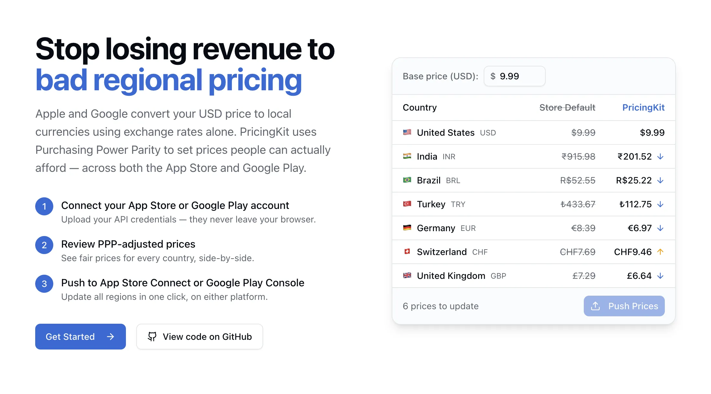

# PricingKit

Free, open-source regional pricing tool for the App Store and Google Play. Set PPP-adjusted prices across 175+ territories in one click. Your credentials are sent only to the server you use, kept in an encrypted HttpOnly cookie, and never stored server-side &mdash; or self-host for full control.

## Features

- **Multi-platform support** - Manage pricing for both Google Play and Apple App Store from one interface
- **Regional pricing** - View and edit in-app product pricing by region/territory
- **Subscription management** - Manage subscription base plan pricing
- **Bulk updates** - Update prices across multiple products/regions at once, with skipped items and regions reported
- **Price export** - Download a product's or subscription's current prices as CSV or JSON before you change them
- **Plan, diff, apply (library)** - Build a reviewable JSON plan of price changes, apply it idempotently within a request budget, resume a partial run and undo it from its log (see [Plans](#plans-plan-diff-apply))
- **Currency conversion** - Automatic exchange rate lookups; regions without a rate are flagged and never priced
- **Multiple pricing strategies** - PPP (World Bank), Big Mac Index or Netflix Index for regional pricing
- **Public Index Checker** - Compare regional prices across strategies at `/index-checker` (no auth required)
- **Search & filter** - Find products by SKU/product ID or name

## Getting Started

### Prerequisites

**For Google Play:**
- A Google Cloud project with a service account configured
- Service account JSON credentials with Google Play Developer API access

**For Apple App Store:**
- An App Store Connect API key (.p8 file)
- Your Issuer ID and Key ID from App Store Connect

**See the in-app setup guide** at `/setup-guide` for detailed instructions for both platforms.

### Installation

```bash
npm install
```

### Development

```bash
npm run dev
```

Open [http://localhost:3000](http://localhost:3000) to get started.

### Production Build

```bash
npm run build
npm start
```

A production server refuses sign-in until `ENCRYPTION_KEY` is set (see [Environment Variables](#environment-variables)). Only `npm run dev` works without it.

### Deploying to Cloudflare Workers

The app is built for Cloudflare Workers with [OpenNext](https://opennext.js.org/cloudflare):

```bash
npm run preview   # build and run locally on the Workers runtime (reads .dev.vars)
npm run deploy    # build and deploy with wrangler
```

Set `ENCRYPTION_KEY` (and optionally `OPEN_EXCHANGE_RATES_APP_ID`) as Worker secrets, e.g. `npx wrangler secret put ENCRYPTION_KEY`. Workers have no filesystem, so exchange rates are cached in memory only; on Node they are also cached in `.exchange-rates.json`.

### Checks

```bash
npm test            # Vitest
npm run typecheck   # tsc --noEmit
npm run lint        # ESLint
```

CI runs all three on every pull request. See [CONTRIBUTING.md](CONTRIBUTING.md) for setup and testing conventions, and [CHANGELOG.md](CHANGELOG.md) for behaviour changes.

## Tech Stack

- **Framework**: Next.js 16 (App Router) with TypeScript
- **Styling**: Tailwind CSS 4 + shadcn/ui
- **State**: Zustand + TanStack Query
- **Forms**: React Hook Form + Zod
- **Google Play API**: Custom `fetch` client (service-account JWT signed with Web Crypto)
- **Apple App Store Connect API**: Custom `fetch` client (ES256 JWT)
- **Hosting**: Node (`npm start`) or Cloudflare Workers via OpenNext

## Project Structure

```
src/
├── app/
│   ├── api/              # API routes (Google & Apple endpoints)
│   ├── dashboard/        # Dashboard pages
│   ├── index-checker/    # Public price index comparison tool
│   └── setup-guide/      # Setup instructions
├── components/
│   ├── ui/               # shadcn/ui components
│   ├── layout/           # Layout components
│   ├── pricing/          # Shared pricing components (bulk update, export)
│   ├── products/         # Product components
│   └── subscriptions/    # Subscription components
├── lib/
│   ├── google-play/      # Google Play API integration
│   ├── apple-connect/    # Apple App Store Connect API integration
│   ├── exchange-rates/   # Currency conversion
│   ├── world-bank/       # Live World Bank PPP data
│   ├── pricing/          # Framework-free core: strategies, indexes, Decimal money, snapping, plans, executor
│   ├── adapters/         # Apple and Google Play adapters for the plan executor
│   ├── export/           # Price export (JSON/CSV) transforms
│   └── utils/            # ApiError, retry/backoff, request budget, rate limiting
├── hooks/                # React Query hooks
└── store/                # Zustand stores
```

## Plans: plan, diff, apply

`src/lib/pricing` is a framework-free TypeScript core (no Next.js or React; a test checks the
whole import graph) that the web app, and later a CLI, share. It turns price changes into files
you can review and commit:

| File | `kind` | What it holds |
| --- | --- | --- |
| Plan | `pricingkit.changeset` | Every change a run will make. Each op names a product and territory, the price it expects to find (`before`), the price it sets (`after`) and an idempotency key. Amounts are decimal strings, never floats. |
| Run log | `pricingkit.applyRun` | Per-op status (`pending`, `ok`, `skipped`, `failed`), attempts, the store's response and the price observed before writing. |
| State | `pricingkit.state` | Current prices of one or more products. Phase 0 price exports (`schemaVersion: 1`) import as state. |

```ts
import { buildChangeSet, applyChangeSet, buildUndoChangeSet, serializeChangeSet } from '@/lib/pricing';
import { AppleAdapter } from '@/lib/adapters';
import { RequestBudget } from '@/lib/utils/request-budget';

const budget = new RequestBudget();                       // 3600 requests/hour by default
const apple = new AppleAdapter({ credentials, budget });
const product = { platform: 'apple', type: 'subscription', id: '1234567890' } as const;

const state = await apple.fetchState(product);
const { resolved } = await apple.resolvePricePoints(product, {
  GB: { currency: 'GBP', amount: '26.10' },               // snapped to a live price point
});
const plan = buildChangeSet({ app: { bundleId: 'com.example.app' }, products: [{ state, targets: resolved }] });
await writeFile('plan.json', serializeChangeSet(plan));   // review, commit

const run = await applyChangeSet(plan, { adapter: apple, budget, onUpdate: saveRunLog });
const undo = buildUndoChangeSet(plan, run);               // itself a plan to review and apply
```

- **Idempotent.** Before writing, the executor reads each product and compares every territory
  with its op: already at `after` is skipped, at `before` is applied, anything else fails with
  `STATE_CHANGED` and nothing is sent. Applying a plan twice changes nothing the second time.
- **Resumable.** Pass a saved run back as `run` and only pending or failed ops are retried. The
  run is handed to `onUpdate` before every write (marking the op as attempted) and after it, so
  a log saved before a crash still shows a write that was in flight. An attempted op found at
  its target on resume counts as done by this run (and is undone with it) instead of being sent
  again. If `onUpdate` throws, the run stops before any further write (`stoppedReason:
  PERSIST_FAILED`).
- **Budgeted.** Every request is charged to the `RequestBudget` (Apple's `X-Rate-Limit` feeds it
  too). The run stops before the budget runs dry and leaves the rest pending.
- **Undoable.** The undo plan reverses every op the run applied, newest first, from the `before`
  snapshots. Apple can't remove a territory's current price, so an op that added one is listed as
  not reversible.
- **Safe with scheduled prices.** An Apple scheduled price is only deleted after its replacement
  exists.

Phase 1 covers base prices: Apple subscriptions, Google Play base plans and one-time products.
Apple in-app purchases and offers come later; their op kinds are reserved in the format.

## Environment Variables

Create a `.env.local` file (optional):

```env
# Encrypts credentials in the session cookie. Required everywhere except `next dev`
# (generate with: openssl rand -base64 32)
ENCRYPTION_KEY=your-secure-random-string

# Open Exchange Rates API key (for currency conversion)
OPEN_EXCHANGE_RATES_APP_ID=your-api-key
```

## Security

- Credentials are sent to the PricingKit server you are using (the hosted instance or your own), encrypted with `ENCRYPTION_KEY` (AES-256-GCM), and stored only in an HttpOnly cookie
- The server does not persist credentials; it decrypts them in memory per request to call the Apple/Google APIs
- Short-lived API tokens (Apple JWTs, Google access tokens) are cached in memory, keyed by a hash of the full credential
- Without `ENCRYPTION_KEY`, sign-in is refused (except under `next dev`)
- Sessions expire after 24 hours
- Using a hosted instance means trusting its operator with your credentials; self-host for full control

See [SECURITY.md](SECURITY.md) for the full credential-handling model and how to report a vulnerability.

## License

This project is licensed under the GNU General Public License v3.0 - see the [LICENSE](LICENSE) file for details.

This means you are free to use, modify, and distribute this software, but any derivative works must also be open-sourced under GPL-3.0.

## Support

PricingKit is free and always will be. If you find it useful, consider buying me a coffee!

<a href="https://www.buymeacoffee.com/andyshephard" target="_blank"></a>
